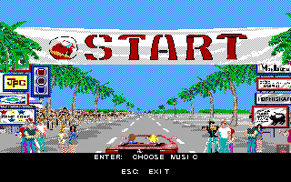
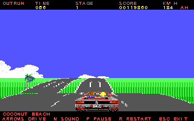

# Tandy OutRun SE

An experimental DOS adaptation of OutRun for Tandy graphics and an 8088-class CPU.

This is the **current 320×200, 16-colour game source**, including its assembly renderer, interface, input, PSG audio playback and asset loader, its executable sprite/sky bank generators, and a [Cannonball](https://github.com/djyt/cannonball)-derived behavior engine. The snapshot matches **OR-H320 / w16h1-320**, with three selectable arcade songs.

It is a source release, not a ready-to-run game download. Sega ROMs, converted graphics/music, executable packages and toolchain binaries are not included.

## Screenshots

Actual 320×200 framebuffer captures from OR-H320 running in 86Box:




[Startup screen](screenshots/startup-320.png)

## Source layout

- `src/game/`: the complete native game assembly and code-side include files.
- `src/engine/`: the current 8088 behavior kernel, geometry/input adapters and multiply helper.
- `tools/`: native builds, executable sprite/sky bank compilers and local-only data extractors.
- `tests/`: build-tool and data-boundary tests.
- `benchmarks/fps.csv`: individual measured runs.

The engine is `opt8-lazy6-s1k`: 8088 code, Open Watcom small model, speed optimization, and a 1 KB reserved stack. The game binds its entry points and data layout directly, so an arbitrary different engine binary cannot be substituted.

## Building on Windows

Requirements:

- Python 3.9 or later.
- Open Watcom 1.9.
- JWasm 2.21.
- Your own OutRun revision-B main-CPU ROMs for the engine.
- A privately held **OR-H320 package** for the game’s embedded asset data.

Build the engine:

```powershell
python tools/build_engine.py --roms D:/private/outrun --watcom C:/WATCOM
```

The ROM directory must contain `epr-10380b.133`, `epr-10382b.118`, `epr-10381b.132` and `epr-10383b.117`. A 256 KB interleaved main-CPU image is also accepted. The extractor generates the required ROM lookup includes locally; the repository contains no ROM payloads.

Build the game:

```powershell
python tools/build_game.py --assets D:/private/OR-H320 --jwasm D:/tools/jwasm.exe --verify-reference
```

This recovers the startup tune, HUD pixels, course lookup and road-width tables from the exact existing OR-H320 `TOSE.COM`, then assembles the public game source. Other package versions are rejected because their embedded-data offsets differ. Omit `--verify-reference` when intentionally changing code.

Rebuild the executable drawing banks from the same private package:

```powershell
python tools/build_draw_banks.py --assets D:/private/OR-H320
```

This recompiles `PLYRCODE.BIN`, `OBJCOD0-2.BIN`, `CAMSKY.BIN` and `CSK00-14.BIN` into `build/draw/`. All **20 banks** were reproduced byte-for-byte. Sprite pixels come from the private `SPRITES.BIN`; two hard-turn poses are recovered from immediate operands in the private `PLYRCODE.BIN`. Sky banks retain the raw rows needed to rebuild their drawing code. The tool checks every regenerated bank before writing output.

Outputs are `build/engine/ENGINE.BIN` and `build/game/TOSE.COM`. Both were freshly rebuilt and compared byte-for-byte with OR-H320: **37,456 bytes** and **36,117 bytes**, respectively.

**Asset-build limitation:** this snapshot does not yet provide a self-contained ROM-to-all-assets pipeline. The existing conversion chain uses additional private decoded images, music and intermediate files. Having only arcade ROMs is sufficient to rebuild the engine, but not the complete game’s asset set. The original package’s other data banks remain necessary to run the game. Generated includes and build outputs are ignored by Git and must not be committed.

Run the source-packaging checks:

```powershell
python -m unittest discover -s tests -v
```

Eighteen tests cover input rejection, ROM interleaving, extraction boundaries, include resolution and sprite/sky code generation. These checks are not full gameplay qualification.

## Running

Use a local copy of the matching OR-H320 data package, keeping its files together. Replace its `TOSE.COM`, `ENGINE.BIN` and executable drawing banks with the matching rebuilt outputs, then run `TOSE` from DOS.

The measured configuration uses Tandy 1000 HX graphics and 640 KB RAM. Memory is tight; a clean DOS boot is recommended. This snapshot has not been tested on physical Tandy hardware.

Controls:

- Enter or Space: skip startup; Enter: start from the radio.
- Up/Down or 1–3: select a song.
- Arrow keys: accelerate, brake and steer.
- A: toggle automatic gears; G: change gear manually; L/H: low/high gear.
- P: pause; M: mute; R: restart; Esc: exit.

## Measured performance

Exact packaged OR-H320, 86Box v7.0 development build, Tandy video, 640 KB, 320×200, music enabled. Two HX runs per CPU clock and one SL/2 run, holding the accelerator without steering from race start for approximately 20 guest seconds.

| Emulated machine / CPU | Run 1 | Run 2 |
| --- | ---: | ---: |
| HX / 8088, 4.77 MHz | 1.42 FPS | 1.42 FPS |
| HX / 8088, 7.16 MHz | 4.74 FPS | 4.65 FPS |
| HX / 8088, 8 MHz | 5.69 FPS | 5.69 FPS |
| SL/2 / 8086, 8 MHz | 9.07 FPS | Not repeated |

FPS counts completed gameplay frames divided by guest PIT time: ticks × 18,643 ÷ 1,193,182. Debugger wall time is excluded. Logic updates stayed near 30 Hz and no engine fault was reported in these seven samples. The [CSV](benchmarks/fps.csv) includes exact clock rates, counts and durations.

These are short emulator measurements, not hardware benchmarks or a full-race performance claim. The 8 MHz HX setting is an emulator comparison, not a stock HX configuration. The supported SL/2 emulation is about 1.93× the 7.16 MHz HX average. It uses an 8086, not a 286; a Tandy 286 result has not been established. Rendering, scenery density, collisions and later routes can change the frame rate.

## Status and credits

This remains an experimental game adaptation. The current snapshot’s native binaries are reproducible with the private inputs above, but complete-game source fidelity, completion of every route and real-hardware compatibility are not established by these checks. Earlier 160-mode experiments are not part of this current 320-mode snapshot.

Cannonball is by Chris White and the Cannonball team. Its derived code retains the upstream **noncommercial** terms in [LICENSE.Cannonball](LICENSE.Cannonball). Please read those terms before redistribution.

OutRun is a trademark of Sega. This project is not affiliated with Sega. No rights to Sega’s game assets are granted by this repository.
